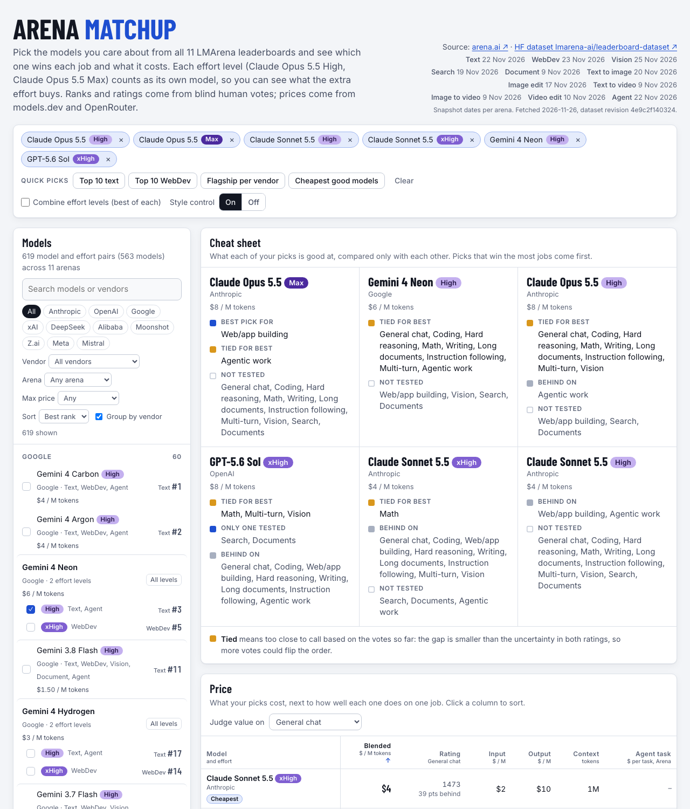

# Arena Matchup

Arena Matchup is a single HTML page for picking an LLM. Choose a few models and it shows which one wins each job, such as coding, writing, web app building or agentic work, and what each one costs. It combines all 11 leaderboards from [LMArena](https://arena.ai) (now arena.ai) with list prices from [models.dev](https://models.dev) and OpenRouter.



The page has four parts:

- A cheat sheet lists what each pick is best at, tied on, or behind on, compared only with your other picks.
- A job board shows, for each job, the winner and how many rating points behind it every other pick is.
- A price table puts blended price per million tokens next to the rating on the job you choose, with one row per model and effort level (Claude Opus 5.5 · High, Claude Opus 5.5 · Max), and marks the cheapest row that is tied with the winner or within 15 points of it.
- A rank matrix shows your picks' rank on every leaderboard and category.

## Quick start

Open `index.html` in a browser. It is one self-contained file with the data embedded, so it needs no server or build step.

To pull fresh data and rebuild it:

```sh
./refresh.sh
```

`refresh.sh` needs [uv](https://docs.astral.sh/uv/) and `python3`. The scripts use only the Python standard library, plus `pyarrow`, which uv installs on the fly to read the Hugging Face parquet files. Prices are cached for 6 hours in `raw/prices/`. If the price fetch fails, the build falls back to that cache, then to the committed `data/prices.json`.

### Speed data

Speed (output tokens per second and time to first token) comes from OpenRouter and is optional. The committed page has none. To include it, set an OpenRouter API key before refreshing:

```sh
OPENROUTER_API_KEY=sk-or-... ./refresh.sh
```

With the key, `scripts/fetch_prices.py` reads per-provider stats from OpenRouter's official endpoints API (`/api/v1/models/<id>/endpoints`). Without a key, that API returns the stats as null and the page hides every speed column and filter.

`--scrape-pages` (or `OPENROUTER_SCRAPE_PAGES=1`) is an opt-in fallback. It reads the same stats from OpenRouter's public model pages. [OpenRouter's terms](https://openrouter.ai/terms) prohibit scraping the site in section 7, so this flag is off by default. Use the API key instead.

## Data sources

| Data | Source | License or terms |
| --- | --- | --- |
| Ranks, ratings, confidence intervals, vote counts, agent cost per task | [`lmarena-ai/leaderboard-dataset`](https://huggingface.co/datasets/lmarena-ai/leaderboard-dataset) on Hugging Face, published by [LMArena](https://arena.ai) | [CC BY 4.0](https://creativecommons.org/licenses/by/4.0/) |
| List prices, context windows, release dates | [models.dev](https://models.dev) ([repo](https://github.com/anomalyco/models.dev)) | MIT |
| Prices for models missing from models.dev, optional speed | [OpenRouter API](https://openrouter.ai/docs) | [OpenRouter terms](https://openrouter.ai/terms) |

The leaderboard data in `index.html` comes from LMArena under CC BY 4.0. This project changes it: it merges effort levels into model families and joins prices. LMArena does not endorse this project.

### Limits

- **Style control is on by default.** For the text, vision, search and document arenas, the page shows LMArena's style-controlled ratings, which discount answer length and formatting. The toggle switches to the raw ratings.
- **Effort levels are merged into families.** "Claude Opus 5.5 (High)" and "(Max)" count as one model, which takes the best rank any of its levels has on each leaderboard, and the job board and rank matrix name that level ("via High"). "Show each effort level separately" splits them again. The price table, its chart and the head-to-head chart always show one row per effort level, each with its own rating; an effort Arena hasn't rated on the chosen job shows as "not ranked". On the Agentic work job the price chart plots Arena's measured cost per task, which differs by effort, instead of the price per token, which doesn't.
- **A tie means the confidence intervals overlap.** A pick is tied with the leader when its upper bound reaches the leader's lower bound. More votes could flip the order.
- **Prices are list prices.** They are US dollars per million tokens before discounts, caching or batch pricing. Blended price is 3 parts input to 1 part output. A † marks OpenRouter's top-level price, which can come from a cheaper third-party host than the model maker.
- **Speed is a 30-minute snapshot.** OpenRouter reports medians over the last 30 minutes, averaged across hosts. Numbers move with load.
- **Name matching is conservative.** A model gets a price only when its name matches exactly or through a hand-checked override in `scripts/fetch_prices.py`. In the committed snapshot, 3 of the 44 model families in the text top 50 have no price.

## Files

```
index.html                 the page; open it directly
refresh.sh                 fetch data, then rebuild index.html
scripts/
  fetch_arena.py           Hugging Face dataset to data/arena.sqlite and data/arena_latest.csv
  fetch_prices.py          models.dev and OpenRouter to data/prices.json
  build_page.py            SQLite and prices.json to index.html (--fragment for body-only HTML)
  page_template.html       page markup, styles and script; build_page.py fills in the data
data/prices.json           price snapshot, committed so the page builds offline
docs/                      README screenshots
```

`data/arena.sqlite`, `data/*.csv` and `raw/` are generated and not committed. `fetch_arena.py --backfill` loads the full rating history into the SQLite database.

## License

The code is MIT, see [LICENSE](LICENSE). The data keeps its sources' licenses, listed above.
